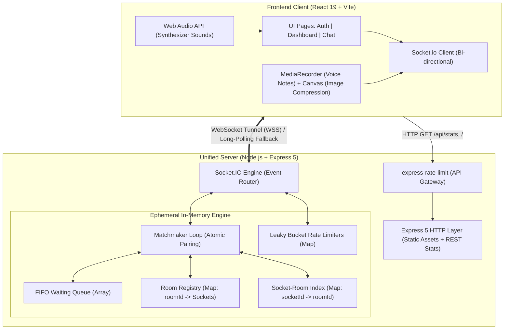
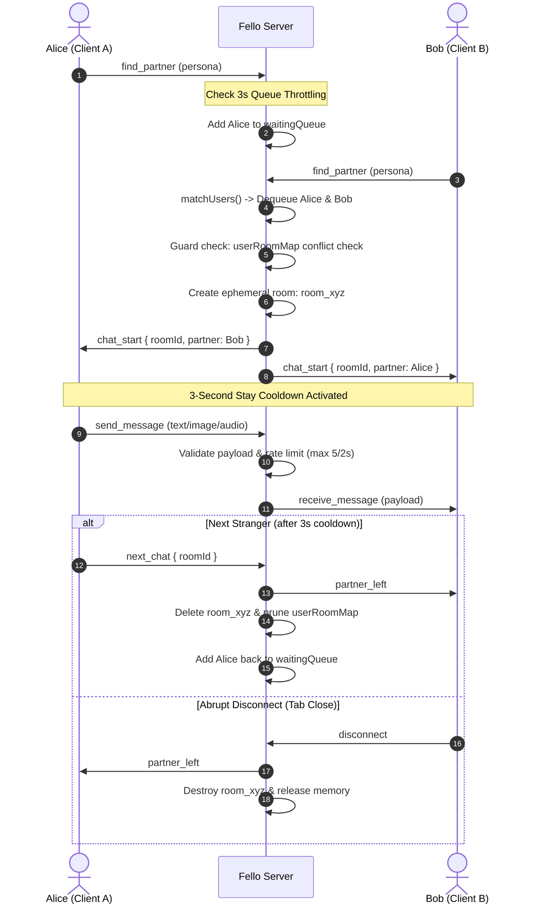

# FELLO — Privacy-First Anonymous 1-on-1 Realtime Web App ⚡

[](https://nodejs.org/)
[](https://react.dev/)
[](https://expressjs.com/)
[](https://socket.io/)
[](https://vitejs.dev/)

> **Fello** is a production-grade, privacy-first 1-on-1 anonymous real-time chat web application. Engineered with **React 19**, **Node.js/Express 5**, and **Socket.IO**, Fello features pure random stranger matchmaking, encrypted ephemeral media sharing (photos & voice notes), robust rate limiting, anti-spam protections, and zero-retention session destruction.

---

## 📑 Table of Contents
- [Architecture & System Flow](#-architecture--system-flow)
- [Pillar 1: Core Functionality](#-pillar-1-core-functionality)
- [Pillar 2: Temporary Sessions & Zero Data Retention](#-pillar-2-temporary-sessions--zero-data-retention)
- [Pillar 3: Backend Reliability & Concurrency](#-pillar-3-backend-reliability--concurrency)
- [Pillar 4: Security & Anti-Abuse Systems](#-pillar-4-security--anti-abuse-systems)
- [Pillar 5: Deployment & Cold-Start Optimization](#-pillar-5-deployment--cold-start-optimization)
- [Pillar 6: Architectural Decisions & Trade-Offs](#-pillar-6-architectural-decisions--trade-offs)
- [Project Structure](#-project-structure)
- [Local Setup & Development](#-local-setup--development)
- [Production Deployment](#-production-deployment)

---

## 🏛 Architecture & System Flow

### System Architecture Diagram


### Matchmaking & Chat Lifecycle State Machine


---

## 🎯 Pillar 1: Core Functionality

### 1. Anonymous Matchmaking
- **FIFO Queue Matching Engine**: Sockets join a thread-safe in-memory queue. As soon as two active peers are detected, the server extracts both, pairs them into a isolated room identifier (`room_<timestamp>_<hash>`), and links them via Socket.IO room namespaces.
- **Pure Random Matching**: Free of arbitrary tag filtering, demographic tracking, or algorithmic prejudice. Pure serendipity.

### 2. Multi-Format Real-Time Messaging & Interactions
- **Instant Messaging**: Sub-50ms message latency routed directly through private socket room namespaces.
- **💬 Message Reactions (Tap / Long-Press)**:
  - Tapping or clicking any message bubble opens a floating glass reaction picker (`❤️`, `🔥`, `😂`, `💀`, `👍`, `😮`).
  - Attached reactions display in a grouped badge tray on the corner of the message bubble with instant synchronization across both peers.
- **✓✓ Double Checkmark Delivery Receipts**:
  - Sent messages show single tick (`✓`) upon server relay, and double checkmarks (`✓✓` in cyan) when delivered to the stranger's active device.
- **📳 Mobile Tactile Haptic Feedback**:
  - Native `navigator.vibrate` integration provides subtle physical feedback when sending messages, receiving chats, tapping reactions, or finding a stranger match.
- **📷 Photo Sharing**:
  - Image attachments with client-side canvas compression to ensure instant transmission without overloading memory buffers.
  - Image preview with caption support before sending.
  - Full-screen high-resolution **Lightbox Viewer** with zoom and backdrop blur.
- **🎙️ Audio Voice Notes**:
  - Browser-native `MediaRecorder` captures audio streams without external plugins.
  - Live recording dock with elapsed timer and synchronized audio soundwave visualizer.
  - Custom in-bubble **Audio Player** with play/pause state management, scrubbable progress bar, and precise duration tracking.
- **Typing Indicators**: Real-time `"Stranger is typing..."` broadcasts with automatic debounced clearing.
- **"🎲 Break The Ice" Prompts**: Instant random conversation starter generator.
- **Quick Reaction Tray**: 1-tap emoji reactions (`🔥`, `😂`, `💀`, `🤯`, `👏`, `❤️`, `🚀`).

### 3. Next Chat Transition with 3-Second Anti-Skip Lock
- **3-Second Minimum Stay Cooldown**: To protect against rapid skip botting and negative user experiences, switching to the next stranger requires staying in the room for a minimum of 3 seconds.
- **Dual Enforcement**: The client provides an interactive countdown button (`Next (3s) -> Next (2s) -> Next Stranger`), while the backend server records `room.createdAt` and rejects premature `next_chat` events.

### 4. Robust Disconnect Handling
- **Graceful Termination**: Sockets trigger `leave_chat` when deliberately navigating away or clicking "End Chat".
- **Abrupt Termination**: Browser closing, network disruption, or page reloads trigger the socket engine's `disconnect` event.
- **Partner Notification**: In either event, the surviving partner immediately receives `partner_left`, a synthesized audio chime plays, and a persistent notification banner offers immediate 1-click re-matching.

---

## 🔒 Pillar 2: Temporary Sessions & Zero Data Retention

| Property | Implementation Detail |
| :--- | :--- |
| **Database Persistence** | **None.** No MongoDB, PostgreSQL, MySQL, Redis, or disk-persisted stores. |
| **Server-Side Message Storage** | **Zero.** Messages are strictly transient event payloads; they are forwarded across the socket room and never written to an array, buffer, or disk. |
| **Media Payloads** | Transmitted as compressed base64 payloads through socket memory, immediately flushed once delivered to the peer socket. |
| **Lifecycle Destruction** | When either participant leaves, `rooms.delete(roomId)` purges the room object, `userRoomMap.delete(socketId)` clears user routing, and the Node.js V8 garbage collector frees memory. |
| **Client-Side Storage** | Message logs exist purely within React component state (`useState([])`). Navigating away, skipping stranger, or refreshing instantly purges all history from client memory. |

---

## ⚡ Pillar 3: Backend Reliability & Concurrency

### 1. High Concurrency Handling
- Built on Node.js's single-threaded, non-blocking asynchronous event loop capable of sustaining tens of thousands of concurrent WebSocket connections.
- Fast `O(1)` hash map lookups (`userRoomMap`, `rooms`) ensure instant routing without database query latency or connection pool starvation.

### 2. Race Condition & Matching Conflict Guards
- **The Double-Pairing Hazard**: In high-velocity matching queues, a user could theoretically trigger two match cycles simultaneously.
- **Fello Guard**: `matchUsers()` validates `userRoomMap.has(u1.socketId) || userRoomMap.has(u2.socketId)` before creating any room. If a conflict occurs, the valid user is pushed back to the head of the queue, completely preventing multi-room collision.

### 3. Disconnection Recovery & Orphan Prevention
- If a socket drops while in the `waitingQueue`, the `disconnect` handler strips them from the queue before any matching attempt can pair an offline user.
- Surviving partners are safely disassociated from room IDs so they can immediately search again without residual state locks.

### 4. Server Restart & Cold-Start Tolerance
- If the backend restarts, the Socket.IO client automatically activates exponential backoff reconnection (`socket.io-client` reconnection loop).
- Once the server resumes, the client seamlessly updates its telemetry status, allowing the user to begin searching without requiring a page reload.

---

## 🛡️ Pillar 4: Security & Anti-Abuse Systems

```
[ Incoming Request ]
        │
        ▼
[ Layer 1: HTTP API Rate Limiter ] ───> 100 requests / 15 minutes max
        │
        ▼
[ Layer 2: Socket Connection & Profile Sanitization ] ───> Sanitize nickname, restrict avatar
        │
        ▼
[ Layer 3: Queue Search Rate Limiting ] ───> 3-second throttle on matching queue entry
        │
        ▼
[ Layer 4: Chat Room Minimum Stay ] ───> 3-second lockout before Next Stranger allowed
        │
        ▼
[ Layer 5: Message Leaky Bucket Throttle ] ───> Max 5 messages / 2-second burst
        │
        ▼
[ Layer 6: Payload Boundary Validation ] ───> Text: max 2,000 chars | Media: max 15MB
        │
        ▼
[ Broadcast to Partner Socket ]
```

### 1. Rate Limiting Multi-Tier Defense
- **HTTP Gateway**: `express-rate-limit` protects REST endpoints (`/api/stats`, `/api/login`) from credential stuffing or DoS attacks.
- **WebSocket Message Flood Limiting**: In-memory token bucket tracking each socket's timestamps. Users sending over 5 messages in 2 seconds are throttled with a `rate_limited` socket alert.
- **Queue Spam Protection**: Sockets must wait 3 seconds before requesting a new match to avoid queue flooding.

### 2. Payload Validation & Sanitization
- **Text Bounds**: Text inputs are trimmed and bounded to 2,000 characters to prevent buffer overflow and memory degradation.
- **Media Payload Capping**: Base64 image and audio payloads are capped at 15MB on the server.
- **Client-Side Downsampling**: Images selected on the frontend are downsampled through an offscreen HTML5 Canvas (max 1280px dimension, 0.8 JPEG quality) before transmission.

### 3. Safe Anonymous Personas
- No IP addresses, device serials, or identifying browser fingerprints are captured or forwarded to strangers.
- Users choose custom nicknames or randomize one-click aliases with sanitized avatar emojis.

---

## 🚀 Pillar 5: Deployment & Cold-Start Optimization

### 1. Mobile Responsiveness & Adaptive UX
- Fully responsive CSS grid layout (`.dashboard-main-grid`) automatically switches from a two-column desktop view to a clean stacked mobile interface below 860px.
- Compact mobile navbar, touch-optimized voice note recorder, responsive chat bubbles, and mobile-safe photo lightboxes.

### 2. Unified Single-Port Architecture
- Express 5 is configured to serve the production Vite bundle (`dist/`) directly alongside the Socket.IO server:
```javascript
// Express 5 compatible SPA Catch-All
app.use((req, res) => {
  res.sendFile(path.join(__dirname, 'dist', 'index.html'));
});
```
- Eliminates Cross-Origin Resource Sharing (CORS) complexity and ensures frontend and backend deploy as one unified artifact on services like Render, Railway, or Fly.io.

### 3. Render Free-Tier Wake-From-Sleep UX
- Free-tier servers on Render spin down after 15 minutes of inactivity, taking 30–50 seconds to boot on the next request.
- **Live Health Status Pill in Navbar**:
  - `🟢 Zero-Logs P2P Routing`: Connected and ready.
  - `🟡 Connecting to server... (Waking up)`: Informs the user the container is spinning up, avoiding user abandonment.

---

## ⚖️ Pillar 6: Architectural Decisions & Trade-Offs

| Decision | Chosen Solution | Alternative Considered | Rationale / Trade-Off |
| :--- | :--- | :--- | :--- |
| **Transport Protocol** | **WebSockets via Socket.IO** | WebRTC DataChannels | WebRTC requires STUN/TURN traversal infrastructure and complex peer signaling; Socket.IO provides rock-solid, firewall-friendly bi-directional tunnels with automatic HTTP long-polling fallbacks. |
| **State Storage** | **Volatile In-Memory Maps** | Redis / PostgreSQL | Eliminates any chance of data leaks or privacy violations. Since anonymous chat rooms are ephemeral by design, in-memory state provides maximum speed ($O(1)$) with zero storage cost. |
| **Image Compression** | **Client-Side Canvas** | Server Sharp/ffmpeg | Offloads heavy CPU encoding from the Node.js server to client hardware, preserving backend throughput for real-time messaging. |
| **Audio Effects** | **Web Audio API Oscillators** | MP3/WAV Audio Files | Zero HTTP requests for audio assets, zero bundle weight, instant playback with zero buffering delay, fully customizable synthesizers. |
| **Queue Logic** | **Pure Random FIFO** | Interest/Tag Filter | Removes biased matchmaking queues, eliminates empty queue deadlocks, and guarantees fastest possible time-to-match. |

---

## 📁 Project Structure

```
Fello/
├── server.js               # Express 5 + Socket.IO server (matchmaking, throttling, routing)
├── package.json            # Scripts, dependencies, and project metadata
├── vite.config.js          # Vite configuration with React plugin
├── index.html              # HTML entry point with Google Fonts & responsive meta
├── dist/                   # Production build artifact (compiled via npm run build)
├── src/
│   ├── main.jsx            # React root mount
│   ├── App.jsx             # Top-level state coordinator, socket event dispatcher
│   ├── index.css           # Design system tokens, glassmorphism, responsive grid
│   ├── components/
│   │   └── Navbar.jsx      # Header with brand, server wake badge, sound toggle, logout
│   ├── pages/
│   │   ├── AuthPage.jsx    # Login / Sign Up / Anonymous alias generator
│   │   ├── DashboardPage.jsx # Pulsing radar matchmaking terminal & live telemetry
│   │   └── ChatPage.jsx    # 1-on-1 chat, photo lightbox, voice recorder, audio player
│   └── utils/
│       ├── socket.js       # Auto-detecting Socket.io connection client
│       └── sound.js        # Web Audio API synthesized sound generator
└── README.md               # Technical portfolio documentation
```

---

## 💻 Local Setup & Development

### Prerequisites
- **Node.js** >= 18.0.0
- **npm** >= 9.0.0

### 1. Clone & Install
```bash
git clone https://github.com/Mycboy/Fello.git
cd Fello
npm install
```

### 2. Start Full Stack Dev Server
```bash
npm run dev
```
- **Backend Socket.IO Server**: `http://localhost:5000`
- **Frontend Vite Web App**: `http://localhost:5173`

### 3. Verify Between Two Browsers
1. Open `http://localhost:5173` in **Browser 1** (e.g. Chrome).
2. Open `http://localhost:5173` in **Browser 2** or an Incognito window.
3. Select nicknames and click **"Find Random Stranger"** on both tabs.
4. Test real-time messaging, photo upload, voice note recording, and the 3-second Next Stranger cooldown!

---

## 🌐 Production Deployment

### Building for Production
```bash
npm run build
npm start
```
The server will boot on `PORT` (default `5000`) and serve the optimized static client from `dist/`.

### Deploying to Render.com
1. Create a **New Web Service** connected to your GitHub repository.
2. Configure settings:
   - **Environment**: `Node`
   - **Build Command**: `npm install && npm run build`
   - **Start Command**: `npm start`
3. Click **Deploy Web Service**!

---

## 📜 License
MIT License. Built for privacy, speed, and real-time connection.
